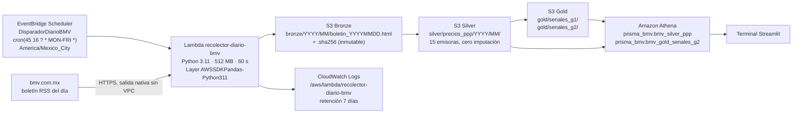

# Prisma BMV: arquitectura en AWS y especificación de conexión

> Para el entorno educativo sin App Runner ni CloudFront, la ruta local con
> acceso S3 y sus limitaciones se describe en
> `docs/ARQUITECTURA_CUENTA_EDUCATIVA.md`. No se ha desplegado una API nueva.

> **Estado verificado el 18-11-2026.** La descripción histórica de las
> secciones 1–7 de este archivo corresponde a la implementación alternativa
> `infra/lambda/recolector_diario_bmv/`, no necesariamente a AWS actual.
> `infra/deploy_aws.sh`, la carga inicial y la creación de DDL históricos están
> bloqueados para evitar sobrescribir recursos y contratos. No los habilite ni
> ejecute manualmente sus operaciones contra producción.

## AWS activo y contrato Gold

La Lambda activa observada `recolector-diario-bmv` corresponde al archivo
`lambda_function_con_ia.py`: Python 3.11, 512 MB, timeout 120 s y capa
AWSSDKPandas Python 3.11. El Scheduler `DisparadorDiarioBMV` apuntaba a esa
función, con cron 16:45 Ciudad de México y sin reintentos configurados. Estos
valores son una instantánea, no una garantía sobre despliegues posteriores.

Gold activo es `gold/senales_g2/registro_senales_prospectivas_panel_g2.csv`.
La tabla comprobada es `default.bmv_gold_senales_g2`; utiliza OpenCSVSerde,
42 columnas y orden idéntico al CSV. La plantilla de creación para una tabla
**nueva** es `infra/athena/11_gold_g2_lambda_activa_referencia.sql`. `CREATE
IF NOT EXISTS` no actualiza una tabla ya existente y no valida los archivos.
Si se modifica el contrato de Glue debe preservarse su definición anterior,
verificarse previamente cada encabezado y probar el resultado con Athena.

Para verificar la situación actual sin escribir en AWS ni ejecutar Athena:

```powershell
python scripts/verificar_contrato_aws.py --bucket <bucket> --region us-east-1
```

La comprobación lee todos los CSV no vacíos del prefijo, su encabezado y el
catálogo Glue. Exige el orden y los tipos del DDL activo, serde, parámetros
principales y ubicación esperada. No verifica filas completas ni garantiza el
esquema que producirá la siguiente ejecución; AWS CLI y permisos de lectura son
necesarios. Lectura de S3 puede generar tráfico y costos.

**No mezclar implementaciones:** `infra/athena/0*.sql`, `prisma/domain/bmv_core.py`
y el recolector de `infra/lambda/` definen otro contrato y otra ruta de
procesamiento. `scripts/crear_tablas_athena.py --solo-imprimir` permite
inspeccionar esos DDL antiguos, pero su ejecución está bloqueada.
`scripts/bootstrap_lakehouse.py` también está bloqueado: sobrescribiría objetos
existentes. Una migración futura requiere fuente de datos autorizada, prefijos
aislados, pruebas de paridad, validación de encabezados y aprobación expresa;
no hay un despliegue productivo automatizado habilitado actualmente.

La API FastAPI local usa archivos locales; no se ha verificado el origen de una
API desplegada. La revisión de solo lectura del 19-11-2026 en `us-east-1`
no encontró APIs Gateway, clústeres ECS ni aplicaciones Amplify; App Runner y
CloudFront denegaron el acceso. No se descarta otra región o proveedor. Véase
`docs/AVANCE_PENDIENTES_CAPTURA_IPC.md`. El repositorio Streamlit consulta Glue y aplica el filtro
`anio` solo cuando la tabla Silver declara esa partición. Una prueba contra
`default` devolvió 195 filas de Silver; no equivale a una validación integral de
Streamlit ni de las demás tablas. Requiere `glue:GetTable` y permisos de Athena
y S3, además de configurar `PRISMA_ATHENA_DATABASE=default` para esa base.
Sin particiones se escanean potencialmente más datos y aumenta el costo.
La plantilla IAM `infra/iam/politica_terminal_streamlit.json` usa
`${DATABASE}` para autorizar únicamente la base elegida; debe sustituirse junto
con las demás variables antes de una eventual aplicación. No se cambió IAM
desplegado.
Las secciones siguientes son documentación histórica de la otra implementación,
no instrucciones de operación del despliegue activo.

## Laboratorio aislado de migración y reversión

Se creó el stack `prisma-bmv-aislado-prueba-2026` en `us-east-1`, con bucket
propio versionado, base Glue `prisma_bmv_aislado_prueba_2026`, tabla
`gold_g2_sintetico` y Lambda de salud independiente. No tiene Scheduler, no
contiene el recolector real y no consume fuentes de mercado. Usa `LabRole`
existente, no un rol de mínimo privilegio; antes de usarlo fuera de un laboratorio
se debe revisar IAM. El bucket tiene `DeletionPolicy: Retain`: borrar el stack
**no elimina** el bucket ni sus versiones. El stack y sus recursos permanecen y
pueden generar costos.

La plantilla se genera con:

```powershell
python scripts/entorno_aislado.py plantilla --salida <ruta-temporal.json>
aws cloudformation validate-template --region us-east-1 --template-body file://<ruta-temporal.json>
```

Para un stack nuevo, revisar el cambio y desplegar con un nombre
`prisma-bmv-aislado-<sufijo>` y un `RoleArn` Lambda permitido. No usar nombres,
buckets ni tablas de producción. La plantilla crea un entorno nuevo, **no
promueve cambios** a producción:

```powershell
aws cloudformation deploy --region us-east-1 --stack-name prisma-bmv-aislado-<sufijo> --template-file <ruta-temporal.json> --parameter-overrides RoleArn=<rol-lambda>
```

Con `boto3` instalado y únicamente archivos sintéticos, la migración agrega una
versión inmutable bajo `releases/<version>/` y cambia la ubicación Glue con
control optimista de versión. El CSV debe tener las 42 columnas del DDL, filas
completas e IDs únicos `SINTETICO_...`; esa convención no garantiza por sí misma
que el contenido sea ficticio: el operador debe asegurarlo. Anote la
`version_glue_anterior` devuelta. El comando de reversión recupera esa versión
archivada y actualiza la ubicación y el esquema sin borrar archivos.

```powershell
python scripts/entorno_aislado.py migrar --stack prisma-bmv-aislado-<sufijo> --version v1 --csv <archivo-sintetico.csv>
python scripts/entorno_aislado.py revertir --stack prisma-bmv-aislado-<sufijo> --version-glue <version-glue-anterior>
```

Si el objeto se escribe pero falla el cambio Glue, queda una versión huérfana:
no se elimina automáticamente y no se debe reutilizar su nombre. No ejecutar
actualizaciones CloudFormation concurrentes con migraciones; cambiar la tabla
directamente introduce *drift* y un despliegue posterior podría restaurar su
configuración original. No existe promoción automática a producción, ni
reversión de Lambda, ingesta o aplicación en producción.

Prueba AWS realizada: `v1` y `v2` con una fila ficticia cada una; Athena leyó
`SINTETICO_2` con probabilidad 0.75 para `v2` y, después de revertir a la versión
Glue `1`, leyó `SINTETICO_1` con 0.25 en `v1`. La Lambda de salud respondió
`AISLADO` y `fuentes_mercado: false`. Ambas versiones y resultados de Athena
permanecen en el bucket aislado. La prueba no valida el recolector real ni
autoriza copiar datos de mercado.

## Laboratorio AWS de captura provisional

El stack separado `prisma-bmv-captura-aislada-2026` tiene su propio bucket
versionado, base `prisma_bmv_captura_aislada_2026`, Lambda de captura y tabla
`silver_captura_provisional_v1`. No hay Scheduler ni inferencia. Este es un
laboratorio **distinto** del stack que solo contiene datos sintéticos.
Ambos stacks permanecen en AWS y pueden generar costos; sus buckets tienen
política de retención y no se borran automáticamente con el stack.

- Plantilla: `infra/captura_ampliada_aislada/template.yaml`.
- Handler: `infra/lambda/captura_ampliada_aislada/handler.py`.
- Empaquetado sin sobrescritura: `scripts/empaquetar_captura_aislada.py`.
- Se usó `LabRole`, que no garantiza mínimo privilegio; no usar el laboratorio
  como despliegue de producción. La Lambda tiene concurrencia reservada de 1.
- El paquete fuente está almacenado bajo `artifacts/captura-ampliada/` en el
  bucket del laboratorio previo, identificado por SHA-256. El bucket nuevo
  recibe Bronze, Silver y manifiestos bajo `experimental/v1/`.
- Se activa manualmente mediante `{"fecha":"2026-11-17"}`. Solo se admite
  el corte del catálogo empaquetado; la fecha se valida antes de descargar.
  Ni los aliases provisionales ni los resultados habilitan señales.
- Silver usa 15 columnas específicas y OpenCSVSerde; no comparte el prefijo
  ni la tabla Silver productiva. Athena registra todos los CSV de ese prefijo:
  no debe hacerse una unión con producción ni considerarse serie canónica.

### Resultado de las pruebas

La captura inicial en AWS del 17-11-2026 produjo 35 filas: 16 PPP observados y
19 no encontrados en las tablas parciales. La consulta Athena
`de36db0b-dc0d-47d6-bf5b-c1b480b84f9c` verificó 35 pares únicos, 16 precios,
una firma y ningún estado de composición distinto de provisional. Las 35 filas
coincidieron con la captura local al comparar todas las columnas excepto el
hash del boletín.

Las firmas del HTML local y del HTML descargado por Lambda diferían. La
comparación de esas dos copias encontró una diferencia en un script dinámico
`f5_cspm` posterior al HTML; esto explica la diferencia observada, pero no
autoriza ignorar otras diferencias futuras. Se conservaron sus hashes de bytes
originales, sin normalización.

Tras identificar el riesgo se actualizó **solo la Lambda aislada**: ahora
rechaza un hash distinto para una fecha ya capturada en lugar de añadir otro
CSV. La reejecución real fue bloqueada con
`HASH_DIVERGENTE_REQUIERE_REVISION` y sigue habiendo un solo Silver. Esa
descarga divergente no se guarda; se requiere revisión manual antes de
reprocesar. El bloqueo de hash idéntico y los conflictos se probaron con
dobles locales. La serialización con concurrencia 1 protege esta Lambda, no
impide escrituras manuales o de otros roles en el bucket.

Una invocación para 18-11-2026 se rechazó antes de descargar porque no hay un
catálogo fechado para esa sesión. Actualmente solo existe la instantánea del
17-11-2026; probar otras fechas requiere nuevas versiones de catálogo con
evidencia de cada corte, sin extender la vigencia por suposición. Las pruebas
no validan composición oficial, modelos, ejecución de producción ni un
despliegue/reversión productivo.

## Flujo de extremo a extremo



## 1. Amazon S3: data lake con arquitectura Medallion

El bucket es privado: tiene el bloqueo de acceso público activado en sus cuatro opciones, cifrado SSE-S3 (AES-256) con Bucket Key y una política que rechaza cualquier petición sin TLS (`infra/iam/politica_bucket_solo_tls.json`).

| Capa | Ruta | Contenido | Regla |
|---|---|---|---|
| Bronze | `bronze/YYYY/MM/boletin_YYYYMMDD.html` y `.sha256` | HTML crudo del boletín y su firma | No se sobrescribe. Si la BMV sirve otro contenido en la misma URL, se guarda aparte como `boletin_YYYYMMDD__<sha12>.html` y la Lambda responde 409. |
| Silver | `silver/precios_ppp/YYYY/MM/ppp_15_emisoras_YYYYMMDD.csv` | Siempre 15 filas por sesión | Una emisora ausente queda como `NO_PUBLICADA_EN_BOLETIN_RSS_DEL_DIA`, con precio vacío. |
| Silver (operativa) | `silver/serie_unificada_reciente.csv` | Últimas 60 sesiones | Es la entrada de la ventana de 21 sesiones. Está fuera de `precios_ppp/` para que Athena no la lea dos veces. |
| Gold | `gold/senales_g2/registro_senales_prospectivas_panel_g2.csv` | Señales G2 y su seguimiento hasta t+5 | Una señal emitida nunca se reescribe; solo se actualizan sus campos de seguimiento. |
| Gold | `gold/senales_g1/registro_senales_prospectivas_walmex.csv` | Señales de 1ª generación | Se publican desde el monitor local con `bootstrap_lakehouse.py`. |
| Gold | `gold/modelos/registro_modelos_g2_oficial.json` | Coeficientes y escaladores congelados | Es la única fuente de parámetros que usa la Lambda. |
| Gold | `gold/auditoria_ventanas_g2/estado_ventanas_YYYYMMDD.csv` | Elegibilidad por emisora | Registra qué emisoras quedaron bloqueadas por huecos y por qué. |
| Athena | `athena-results/` | Resultados de consultas | Una regla de ciclo de vida los purga a los 30 días. |

Todos los CSV se escriben en UTF-8 sin BOM. Si llevaran BOM, Athena lo leería como parte del nombre de la primera columna.

## 2. AWS Lambda `recolector-diario-bmv`

- **Runtime:** Python 3.11, con 512 MB de memoria y 60 s de timeout. El handler es `lambda_function.lambda_handler`.
- **Sin VPC:** sale a internet por la red nativa de Lambda, sin NAT Gateway, y por eso la descarga desde `bmv.com.mx` no cuesta nada.
- **Layer:** `AWSSDKPandas-Python311`, la capa oficial de AWS con pandas, numpy, pyarrow y boto3. El paquete propio solo lleva `lambda_function.py` y `bmv_core.py`, que en total pesan menos de 30 KB.
- **Variables de entorno:** `BUCKET_NAME` es obligatoria. `MODELOS_KEY`, `SERIE_KEY` y `GOLD_G2_KEY` tienen valores por defecto. `FERIADOS_BMV_EXTRA` sirve para cargar el calendario oficial de años posteriores a 2026.
- **Backfill:** si se perdió una sesión, se reprocesa con `{"fecha": "YYYYMMDD"}`. Mientras falte una sesión, la ventana de 21 queda incompleta y la Lambda no emite señales: es el comportamiento correcto bajo la política de cero imputación.

Estados que devuelve la Lambda:

| Estado | HTTP | Significado |
|---|---|---|
| `EXITO` | 200 | Bronze, Silver y Gold actualizados. |
| `DIA_INHABIL_BMV` | 200 | Feriado oficial o fin de semana; no se descarga nada. |
| `BOLETIN_NO_PUBLICADO` | 404 | La BMV aún no publica el boletín. Reintente con backfill más tarde. |
| `ERROR_DESCARGA` | 502 | Timeout o fallo de red. |
| `HASH_DIVERGENTE_REQUIERE_REVISION` | 409 | El contenido cambió respecto al ya ingerido; se conservan ambas copias. |

## 3. Amazon EventBridge Scheduler

La programación `DisparadorDiarioBMV` usa `cron(45 16 ? * MON-FRI *)` con zona horaria `America/Mexico_City`, sin ventana flexible y con 2 reintentos (`infra/eventbridge/disparador_diario_bmv.json`). Desde 2022 México no aplica horario de verano, así que las 16:45 locales equivalen siempre a las 22:45 UTC.

## 4. Amazon Athena

Los DDL están en `infra/athena/` y los crea `scripts/crear_tablas_athena.py`.

- **Lectura por posición:** OpenCSVSerde lee las columnas por posición. Por eso el orden se define una sola vez en `prisma/domain/bmv_core.py` (`COLUMNAS_SILVER`, `COLUMNAS_GOLD_G2`), y la Lambda, la carga inicial y el DDL lo respetan. Hay una prueba automática que lo verifica.
- **Huecos como NULL:** con `use.null.for.invalid.data = true`, los huecos llegan como `NULL` en las columnas `DOUBLE`. AWS advierte que esta propiedad también oculta datos mal formados. Para compensarlo, la Lambda escribe los enteros sin `.0` y la terminal ejecuta controles de integridad sobre los datos cargados.
- **Particiones:** `bmv_silver_ppp` usa proyección de particiones (`anio`, `mes`), así que no hace falta `MSCK REPAIR TABLE`. Filtre siempre por `anio` y `mes` para limitar lo escaneado.
- **Costo:** Athena cobra 5 USD por TB escaneado con un mínimo de 10 MB por consulta. Con este volumen, cada consulta cuesta alrededor de 0.00005 USD.

## 5. IAM y CloudWatch

- **LabRole en AWS Academy:** en AWS Academy, `LabRole` es un rol preexistente que no se puede editar y concede más permisos de los que la plataforma necesita. Por eso el mínimo privilegio se aplica en dos niveles:
  - El código solo toca los prefijos `bronze/`, `silver/`, `gold/` y `athena-results/`.
  - En una cuenta propia, sustituya `LabRole` por roles con las políticas de `infra/iam/`. La Lambda solo puede leer y escribir en las tres capas y escribir sus propios logs. La terminal solo lee el lakehouse y consulta Athena en su workgroup.
- **Logs:** el grupo `/aws/lambda/recolector-diario-bmv` retiene 7 días. Cada ejecución emite una línea JSON (`{"evento": "fin", "estado": ..., "sha256": ...}`) que se puede consultar con CloudWatch Logs Insights:

  ```
  fields @timestamp, estado, fecha, emisoras_verificadas, senales_g2_nuevas
  | filter evento = "fin" | sort @timestamp desc | limit 30
  ```

## 6. Conexión de la terminal

| Variable | Valor |
|---|---|
| `PRISMA_DATA_SOURCE` | `local` (instantánea en `datos/`), `s3` (lee Silver y Gold directamente) o `athena` (SQL) |
| `PRISMA_S3_BUCKET` | Nombre del bucket |
| `AWS_REGION` | Región del bucket |
| `PRISMA_ATHENA_DATABASE` / `PRISMA_ATHENA_WORKGROUP` | `prisma_bmv` / `primary` |
| `PRISMA_ATHENA_OUTPUT` | Por defecto `s3://<bucket>/athena-results/` |

Las credenciales se toman de la cadena estándar de boto3. En AWS Academy son temporales y vencen al cerrar el laboratorio: copie las nuevas a `~/.aws/credentials` en cada sesión.

## 7. Despliegue

```bash
BUCKET=prisma-bmv-datalake-<sufijo> \
LAYER_ARN=arn:aws:lambda:us-east-1:336392948345:layer:AWSSDKPandas-Python311:<versión> \
./infra/deploy_aws.sh
```

Consulte la versión vigente de la capa en <https://aws-sdk-pandas.readthedocs.io/en/stable/layers.html> o en la consola (Lambda > Capas > Capas de AWS).

Si su cuenta no permite que el Scheduler asuma `LabRole`, cree la programación desde la consola de EventBridge con los mismos valores. El resto del script no depende de ese paso.
