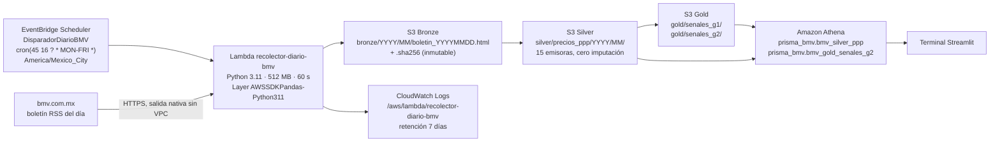

# Prisma BMV: arquitectura en AWS y especificación de conexión

## Flujo de extremo a extremo



## 1. Amazon S3: data lake con arquitectura Medallion

El bucket es privado: tiene el bloqueo de acceso público activado en sus cuatro opciones, cifrado SSE-S3 (AES-256) con Bucket Key y una política que rechaza cualquier petición sin TLS (`infra/iam/politica_bucket_solo_tls.json`).

| Capa | Ruta | Contenido | Regla |
|---|---|---|---|
| Bronze | `bronze/YYYY/MM/boletin_YYYYMMDD.html` y `.sha256` | HTML crudo del boletín y su firma | No se sobrescribe. Si la BMV sirve otro contenido en la misma URL, se guarda aparte como `boletin_YYYYMMDD__<sha12>.html` y la Lambda responde 409. |
| Silver | `silver/precios_ppp/YYYY/MM/ppp_15_emisoras_YYYYMMDD.csv` | Siempre 15 filas por sesión | Una emisora ausente queda como `NO_PUBLICADA_EN_BOLETIN_RSS_DEL_DIA`, con precio vacío. |
| Silver (operativa) | `silver/serie_unificada_reciente.csv` | Últimas 60 sesiones | Es la entrada de la ventana de 21 sesiones. Está fuera de `precios_ppp/` para que Athena no la lea dos veces. |
| Gold | `gold/senales_g2/registro_senales_prospectivas_panel_g2.csv` | Señales G2 y su seguimiento hasta t+5 | Una señal emitida nunca se reescribe; solo se actualizan sus campos de seguimiento. |
| Gold | `gold/senales_g1/registro_senales_prospectivas_walmex.csv` | Señales de 1ª generación | Se publican desde el monitor local con `bootstrap_lakehouse.py`. |
| Gold | `gold/modelos/registro_modelos_g2_oficial.json` | Coeficientes y escaladores congelados | Es la única fuente de parámetros que usa la Lambda. |
| Gold | `gold/auditoria_ventanas_g2/estado_ventanas_YYYYMMDD.csv` | Elegibilidad por emisora | Registra qué emisoras quedaron bloqueadas por huecos y por qué. |
| Athena | `athena-results/` | Resultados de consultas | Una regla de ciclo de vida los purga a los 30 días. |

Todos los CSV se escriben en UTF-8 sin BOM. Si llevaran BOM, Athena lo leería como parte del nombre de la primera columna.

## 2. AWS Lambda `recolector-diario-bmv`

- **Runtime:** Python 3.11, con 512 MB de memoria y 60 s de timeout. El handler es `lambda_function.lambda_handler`.
- **Sin VPC:** sale a internet por la red nativa de Lambda, sin NAT Gateway, y por eso la descarga desde `bmv.com.mx` no cuesta nada.
- **Layer:** `AWSSDKPandas-Python311`, la capa oficial de AWS con pandas, numpy, pyarrow y boto3. El paquete propio solo lleva `lambda_function.py` y `bmv_core.py`, que en total pesan menos de 30 KB.
- **Variables de entorno:** `BUCKET_NAME` es obligatoria. `MODELOS_KEY`, `SERIE_KEY` y `GOLD_G2_KEY` tienen valores por defecto. `FERIADOS_BMV_EXTRA` sirve para cargar el calendario oficial de años posteriores a 2026.
- **Backfill:** si se perdió una sesión, se reprocesa con `{"fecha": "YYYYMMDD"}`. Mientras falte una sesión, la ventana de 21 queda incompleta y la Lambda no emite señales: es el comportamiento correcto bajo la política de cero imputación.

Estados que devuelve la Lambda:

| Estado | HTTP | Significado |
|---|---|---|
| `EXITO` | 200 | Bronze, Silver y Gold actualizados. |
| `DIA_INHABIL_BMV` | 200 | Feriado oficial o fin de semana; no se descarga nada. |
| `BOLETIN_NO_PUBLICADO` | 404 | La BMV aún no publica el boletín. Reintente con backfill más tarde. |
| `ERROR_DESCARGA` | 502 | Timeout o fallo de red. |
| `HASH_DIVERGENTE_REQUIERE_REVISION` | 409 | El contenido cambió respecto al ya ingerido; se conservan ambas copias. |

## 3. Amazon EventBridge Scheduler

La programación `DisparadorDiarioBMV` usa `cron(45 16 ? * MON-FRI *)` con zona horaria `America/Mexico_City`, sin ventana flexible y con 2 reintentos (`infra/eventbridge/disparador_diario_bmv.json`). Desde 2022 México no aplica horario de verano, así que las 16:45 locales equivalen siempre a las 22:45 UTC.

## 4. Amazon Athena

Los DDL están en `infra/athena/` y los crea `scripts/crear_tablas_athena.py`.

- **Lectura por posición:** OpenCSVSerde lee las columnas por posición. Por eso el orden se define una sola vez en `prisma/domain/bmv_core.py` (`COLUMNAS_SILVER`, `COLUMNAS_GOLD_G2`), y la Lambda, la carga inicial y el DDL lo respetan. Hay una prueba automática que lo verifica.
- **Huecos como NULL:** con `use.null.for.invalid.data = true`, los huecos llegan como `NULL` en las columnas `DOUBLE`. AWS advierte que esta propiedad también oculta datos mal formados. Para compensarlo, la Lambda escribe los enteros sin `.0` y la terminal ejecuta controles de integridad sobre los datos cargados.
- **Particiones:** `bmv_silver_ppp` usa proyección de particiones (`anio`, `mes`), así que no hace falta `MSCK REPAIR TABLE`. Filtre siempre por `anio` y `mes` para limitar lo escaneado.
- **Costo:** Athena cobra 5 USD por TB escaneado con un mínimo de 10 MB por consulta. Con este volumen, cada consulta cuesta alrededor de 0.00005 USD.

## 5. IAM y CloudWatch

- **LabRole en AWS Academy:** en AWS Academy, `LabRole` es un rol preexistente que no se puede editar y concede más permisos de los que la plataforma necesita. Por eso el mínimo privilegio se aplica en dos niveles:
  - El código solo toca los prefijos `bronze/`, `silver/`, `gold/` y `athena-results/`.
  - En una cuenta propia, sustituya `LabRole` por roles con las políticas de `infra/iam/`. La Lambda solo puede leer y escribir en las tres capas y escribir sus propios logs. La terminal solo lee el lakehouse y consulta Athena en su workgroup.
- **Logs:** el grupo `/aws/lambda/recolector-diario-bmv` retiene 7 días. Cada ejecución emite una línea JSON (`{"evento": "fin", "estado": ..., "sha256": ...}`) que se puede consultar con CloudWatch Logs Insights:

  ```
  fields @timestamp, estado, fecha, emisoras_verificadas, senales_g2_nuevas
  | filter evento = "fin" | sort @timestamp desc | limit 30
  ```

## 6. Conexión de la terminal

| Variable | Valor |
|---|---|
| `PRISMA_DATA_SOURCE` | `local` (instantánea en `datos/`), `s3` (lee Silver y Gold directamente) o `athena` (SQL) |
| `PRISMA_S3_BUCKET` | Nombre del bucket |
| `AWS_REGION` | Región del bucket |
| `PRISMA_ATHENA_DATABASE` / `PRISMA_ATHENA_WORKGROUP` | `prisma_bmv` / `primary` |
| `PRISMA_ATHENA_OUTPUT` | Por defecto `s3://<bucket>/athena-results/` |

Las credenciales se toman de la cadena estándar de boto3. En AWS Academy son temporales y vencen al cerrar el laboratorio: copie las nuevas a `~/.aws/credentials` en cada sesión.

## 7. Despliegue

```bash
BUCKET=prisma-bmv-datalake-<sufijo> \
LAYER_ARN=arn:aws:lambda:us-east-1:336392948345:layer:AWSSDKPandas-Python311:<versión> \
./infra/deploy_aws.sh
```

Consulte la versión vigente de la capa en <https://aws-sdk-pandas.readthedocs.io/en/stable/layers.html> o en la consola (Lambda > Capas > Capas de AWS).

Si su cuenta no permite que el Scheduler asuma `LabRole`, cree la programación desde la consola de EventBridge con los mismos valores. El resto del script no depende de ese paso.
